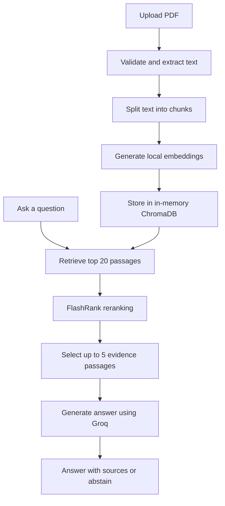

# PDF RAG Assistant

A PDF question-answering application built with Streamlit and Retrieval-Augmented Generation (RAG). Upload a PDF, ask questions, and get answers supported by relevant passages and page references.

**[Live Demo](https://ai-pdf-rag-assistant.streamlit.app/)**

*Note: The app may sleep after inactivity on Streamlit Community Cloud. If prompted, click the wake-up button.*

## Features

- Upload and process PDF documents.
- Choose between pypdf and pdfplumber for text extraction.
- Retrieve relevant passages using semantic search.
- Rerank results before sending selected evidence to the language model.
- Generate answers with source and page references.
- Abstain when the documents do not contain sufficient evidence.

## How It Works



## Run Locally

Python 3.13 or later is required.

```powershell
py -3.13 -m venv .venv
.\.venv\Scripts\Activate.ps1
python -m pip install --upgrade pip
pip install -r requirements.txt
Copy-Item .env.example .env
```

Add your Groq API key to `.env`, then start the application:

```powershell
streamlit run app.py
```

### Configuration

| Variable | Default |
|---|---|
| `GROQ_API_KEY` | Required |
| `GROQ_MODEL` | `openai/gpt-oss-20b` |
| `GROQ_TIMEOUT_SECONDS` | `30` |
| `GROQ_MAX_RETRIES` | `0` |
| `GROQ_TEMPERATURE` | `0` |
| `GROQ_MAX_OUTPUT_TOKENS` | `512` |

Never commit your `.env` file or API key. For Streamlit Community Cloud, add the key through the app's Secrets settings.

## Testing

Run the automated test suite:

```powershell
python -m pytest -q
```

**204 tests passed** during the M11 verification run.

## Evaluation

See [evaluation/report.md](evaluation/report.md) for the evaluation method, results, and limitations.

The evaluation used 20 questions across two PDFs. For the 16 answerable questions, retrieval achieved:

| Metric | Baseline | After Reranking |
|---|---:|---:|
| Hit@5 | 1.00 | 1.00 |
| Recall@5 | 1.00 | 1.00 |
| Precision@5 | 0.525 | 0.5125 |
| MRR | 0.95 | 1.00 |

Reranking improved MRR in this evaluation, while precision decreased slightly. These results come from a small dataset and are not a general performance guarantee.

To reproduce the evaluation, place the required source PDFs in `evaluation/documents/` and run:

```powershell
python evaluation/run_evaluation.py
```

The optional `--generate` flag also runs a small Groq-based answer evaluation and uses API quota.

## Design Choices and Limitations

- **PDF parsing:** pypdf is the default because it was faster in our small comparison. pdfplumber is also available.
- **Retrieval:** Uses local Sentence Transformers embeddings, in-memory ChromaDB, and FlashRank reranking.
- **Answer generation:** Uses Groq-hosted `openai/gpt-oss-20b`. Answers rely on selected document evidence and abstain when evidence is insufficient.
- **Privacy:** Selected document passages are sent to Groq for answer generation. Avoid uploading confidential documents.
- **Storage:** The vector index is held in memory and must be rebuilt when the application restarts.
- **PDF support:** Text extraction only; scanned PDFs requiring OCR are not supported.
- **Hosting:** Streamlit Community Cloud and Groq Free Tier have resource and usage limits. The app may sleep after inactivity. No automatic paid fallback is configured.
